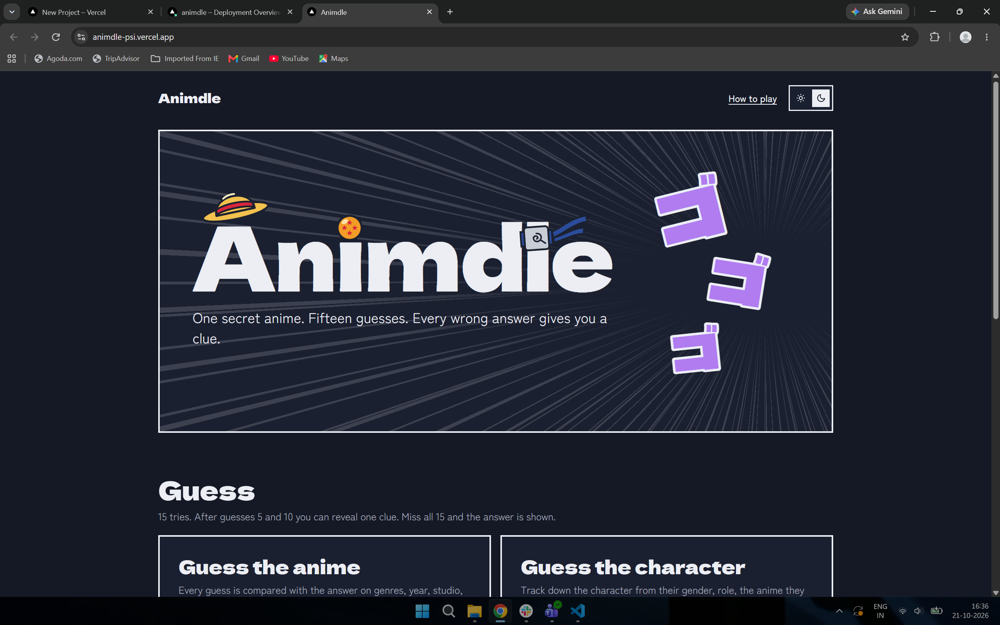
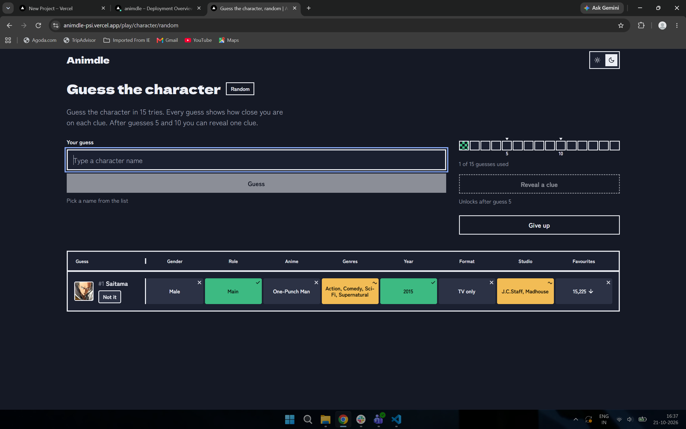
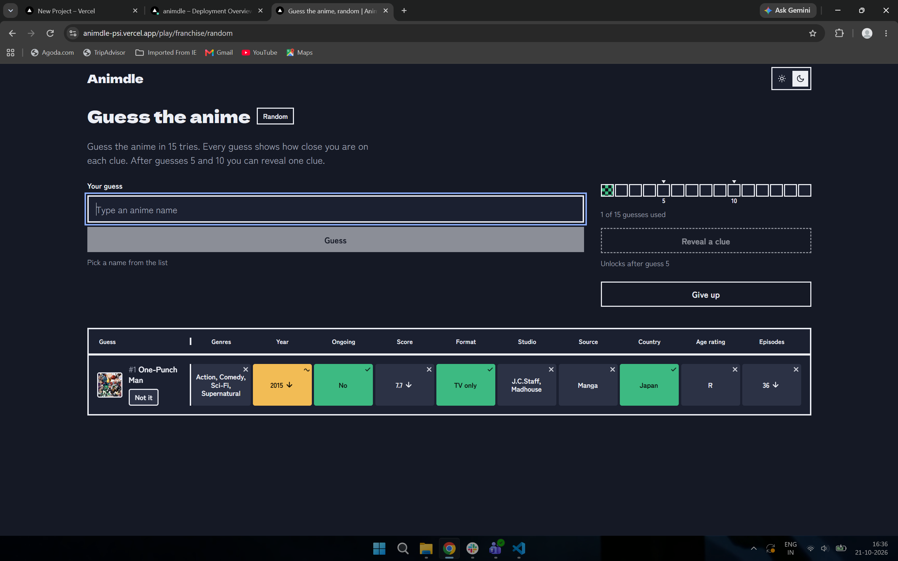
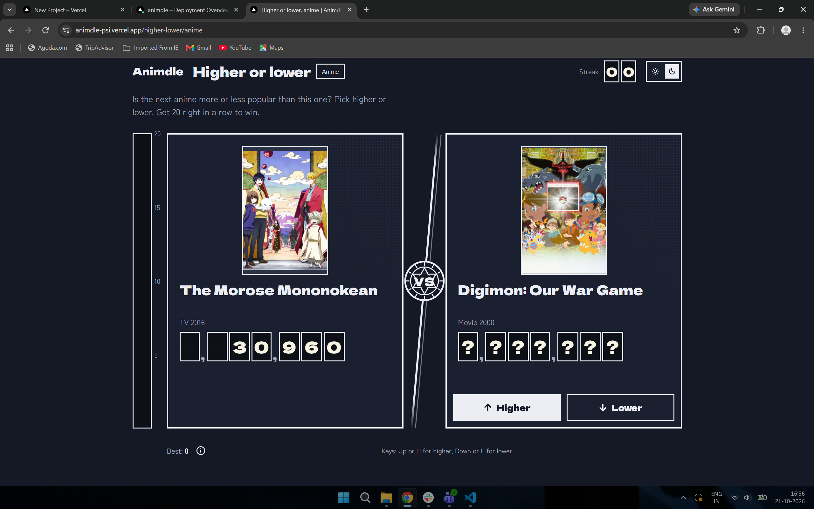
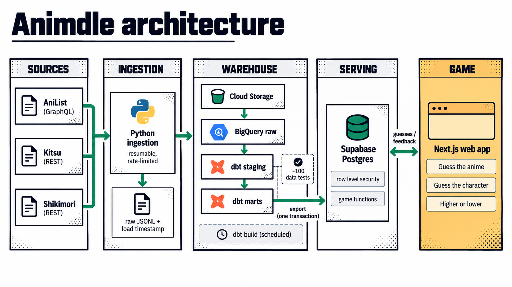
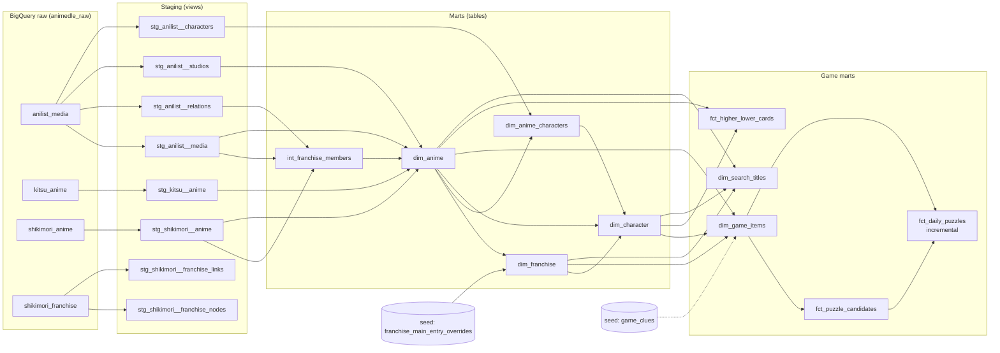

# Animdle

An anime data warehouse with a guessing game on top. Three public anime APIs are landed raw, modelled and tested in
dbt on BigQuery, then served to a Next.js game through Supabase.

The warehouse is the core of the project: raw landing with load timestamps, staging and marts in dbt, franchise
clustering from relation graphs, around 100 data tests, an append-only daily puzzle schedule, and game clue values
defined once in the warehouse. The game is the visible end product.

<!-- Screenshot: home page (night mode) -->
<p align="center"></p>

## The game

| Mode | What you do | Data behind it |
|---|---|---|
| Guess the anime | Name the series in 15 tries. Each guess is graded on genres, year, studio, score, source and more. Hints after guesses 5 and 10. | `dim_franchise` |
| Guess the anime, hard mode | Same, but every season and movie is its own answer. | `dim_anime` |
| Guess the character | Name the character from gender, role, their anime and when it aired. | `dim_character` |
| Higher or lower | Is the next anime (or character) more or less popular? 20 right in a row wins. | `fct_higher_lower_cards` |

Each guess mode has a **daily** puzzle (the same for everyone, frozen in the warehouse) and **random** rounds with
Easy / Normal / Hard difficulty.

<!-- Screenshots: fill these in -->
| Guess the anime | Guess the character | Higher or lower |
|---|---|---|
|  |  |  |


## Architecture

<!-- Architecture diagram -->
<p align="center"></p>


- **AniList** is the catalog: titles, dates, genres, studios, relations, top characters and the MAL id.
- **Kitsu** and **Shikimori** are looked up by MAL id: age rating (Kitsu); score, studios and the franchise graph
  (Shikimori).
- Raw responses are landed untouched as JSONL with a `_loaded_at` timestamp. All transformation happens in dbt.
- BigQuery stays the source of truth and the analytics store. The game reads a small copy in Supabase, because
  per-request BigQuery queries are slow (1 to 2 s) and billed per scan.
- Answers never reach the browser before a game ends: the browser only calls Supabase functions (`start_game`,
  `submit_guess`, `reveal_hint`, `give_up`, `get_game`), which read private tables and return graded feedback.

### dbt lineage


### dbt models
| Layer | Models | Notes |
|---|---|---|
| Staging (views) | `stg_anilist__media`, `stg_anilist__characters`, `stg_anilist__relations`, `stg_anilist__studios`, `stg_anilist__tags`, `stg_kitsu__anime`, `stg_shikimori__anime`, `stg_shikimori__franchise_nodes`, `stg_shikimori__franchise_links` | one per source entity, typed and renamed |
| Intermediate | `int_franchise_members` | franchise clusters (recursive CTE over relation edges) |
| Marts | `dim_franchise`, `dim_anime`, `dim_anime_characters`, `dim_character` | one row per franchise / entry / (anime, character) / character |
| Game marts | `dim_game_items`, `fct_puzzle_candidates`, `fct_daily_puzzles`, `fct_higher_lower_cards`, `dim_search_titles` | guess pool with clue JSON, answer pool with difficulty tiers, incremental append-only daily schedule, autocomplete |
| Seeds | `game_clues`, `franchise_main_entry_overrides` | clue columns and grading rules; hand-picked franchise "face" |

Tests cover uniqueness, not null, relationships, accepted values and custom invariants (every anime belongs to
exactly one franchise, one puzzle per mode per day, every clue key exists for every item).

## Repository layout
| Path | What |
|---|---|
| `ingestion/` | one module per source, resumable and rate-limit aware: `python -m ingestion <step>` |
| `warehouse/` | BigQuery schemas and loader (`load.py`), Supabase schema and export (`supabase_schema.sql`, `export_supabase.py`) |
| `dbt/` | dbt project: sources with freshness checks, staging, intermediate, marts, seeds, tests |
| `web/` | Next.js 16 game (App Router, TypeScript, CSS modules) |
| `tests/` | Python unit tests, plus a check that every landed file fits its BigQuery schema |
| `data/raw/` | landed files (gitignored) |

## Run it locally

### Prerequisites
- Python 3.11+, Node.js 20+ (22 tested), Git
- A Google Cloud project with billing enabled (the free tier covers this project) and the
  [gcloud CLI](https://cloud.google.com/sdk/docs/install)
- A free [Supabase](https://supabase.com) project (only needed for the game)

### 1. Clone and install
```bash
git clone https://github.com/Rahulathreya45/Animdle.git
cd Animdle
python -m venv .venv
source .venv/bin/activate        # Windows: .venv\Scripts\activate
pip install -r requirements.txt  # includes dbt-bigquery
```

### 2. Google Cloud (once)
1. Enable the **BigQuery API** and **Cloud Storage API** for your project.
2. Create a bucket in **`us-central1`** for the raw files (e.g. `<project-id>-animdle-raw`). Every dataset in this
   project also lives in `us-central1`; mixing locations makes queries fail.
3. Log in once with Application Default Credentials (no key files):
   ```bash
   gcloud auth application-default login
   ```

### 3. Environment
```bash
cp .env.example .env
```
Fill in `GCP_PROJECT`, `GCS_BUCKET` and, for the game, `SUPABASE_DB_URL` (step 7). Keep `BQ_LOCATION=us-central1`
and `BQ_RAW_DATASET=animedle_raw` (the dbt project reads that dataset name).

### 4. Ingest the raw data
```bash
python -m ingestion anilist           # full AniList catalog, about 20 min
python -m ingestion all --limit 500   # quick test: Kitsu + Shikimori for the 500 most popular titles
python -m ingestion all               # everything; safe to re-run, it resumes
```
Steps: `anilist`, `kitsu`, `shikimori`, `franchise`, `all`. Kitsu and Shikimori need AniList first (they look titles
up by MAL id). Rate limits: AniList 30 req/min; Shikimori 5 req/s and 90 req/min; Kitsu publishes none, so ingestion
stays at about 2.5 req/s.

### 5. Load into BigQuery
```bash
python -m warehouse.load            # local files -> GCS -> BigQuery raw tables
python -m warehouse.load --direct   # or skip the bucket and load straight from local files
```
Creates the `animedle_raw` dataset and replaces `anilist_media`, `kitsu_anime`, `shikimori_anime` and
`shikimori_franchise` on every run (row counts are checked).

### 6. Build the warehouse with dbt
```bash
cd dbt
export GCP_PROJECT=<your-project-id>   # PowerShell: $env:GCP_PROJECT = "<your-project-id>"
dbt debug --profiles-dir .             # connection test
dbt build --profiles-dir .             # seeds, models and tests
dbt source freshness --profiles-dir .
cd ..
```
The local profile (`dbt/profiles.yml`) uses your gcloud login and builds into `animedle_dev_*` datasets
(`animedle_dev_staging`, `animedle_dev_marts`, ...). A scheduled production job (for example on the dbt platform)
builds the same project into `animedle_prod_*`.

`fct_daily_puzzles` is incremental with `full_refresh = false`, so published daily answers never change. To restart
the schedule before launch, set `puzzle_start_date` in `dbt/dbt_project.yml` and drop that one table.

### 7. Copy the game data to Supabase
1. Create a Supabase project. In **Connect**, copy the **Session pooler** connection string into `SUPABASE_DB_URL`
   in `.env`.
2. Create the schema (tables, row level security, game functions) and export the marts:
   ```bash
   python -m warehouse.export_supabase --init --dataset animedle_dev_marts
   ```
   Drop `--dataset` to export from `animedle_prod_marts` (the default). `--init` is safe to re-run. All tables are
   replaced inside one transaction and row counts are checked, so the game never sees a half-loaded table.

### 8. Run the game
```bash
cd web
npm install
```
Create `web/.env.local` with your Supabase project URL and publishable (anon) key
(Supabase: **Project Settings > API**):
```
NEXT_PUBLIC_SUPABASE_URL=https://<project-ref>.supabase.co
NEXT_PUBLIC_SUPABASE_PUBLISHABLE_KEY=<publishable or anon key>
```
The publishable key is safe in the browser: row level security hides answers and game state.
```bash
npm run dev     # http://localhost:3000
```
Other scripts: `npm run build`, `npm start`, `npm run lint`.

### 9. Tests
```bash
pytest                                 # Python: ingestion helpers and landed-file schema checks
cd dbt && dbt test --profiles-dir .    # data tests
cd web && npm run lint && npx tsc --noEmit
```

## Roadmap
- [ ] Fuzzy / embedding matcher evaluated against the MAL id crosswalk (precision, recall, F1 table here)
- [ ] dbt snapshots (SCD2) of score and airing status
- [ ] Solver simulation to score puzzle difficulty; guess events back to BigQuery to calibrate it
- [ ] Scheduled export to Supabase after the dbt production job (GitHub Actions)

## Data and credits
Anime data from [AniList](https://anilist.co), [Kitsu](https://kitsu.app) and [Shikimori](https://shikimori.one).
Only metadata is stored; images are linked, not rehosted. Animdle is a fan-made project, not affiliated with any of
them or with the rights holders of the series it references.
